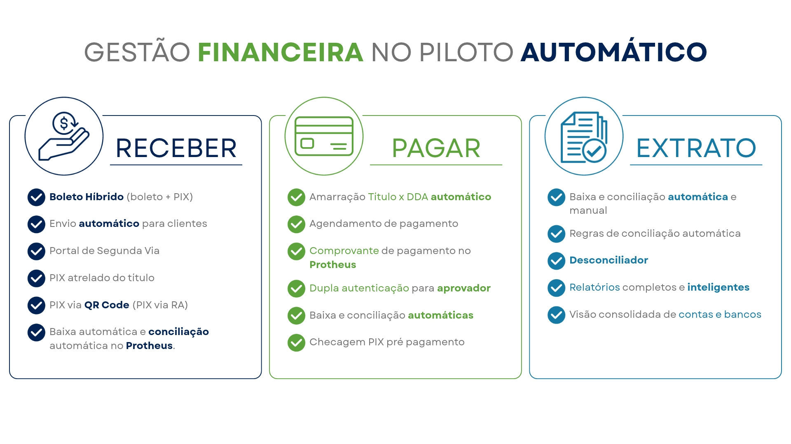
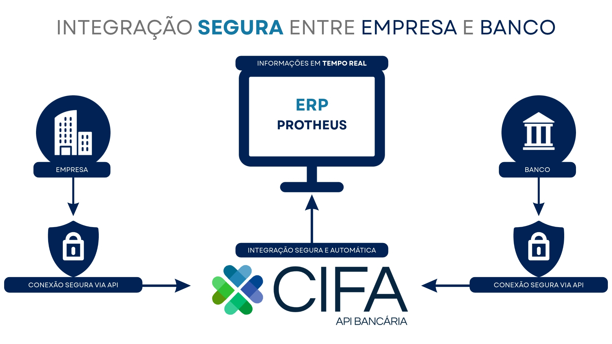
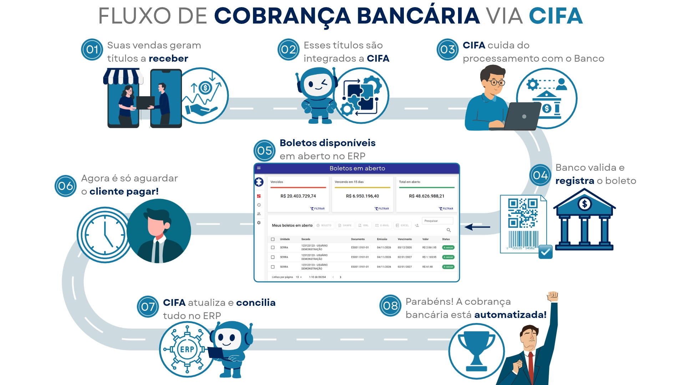
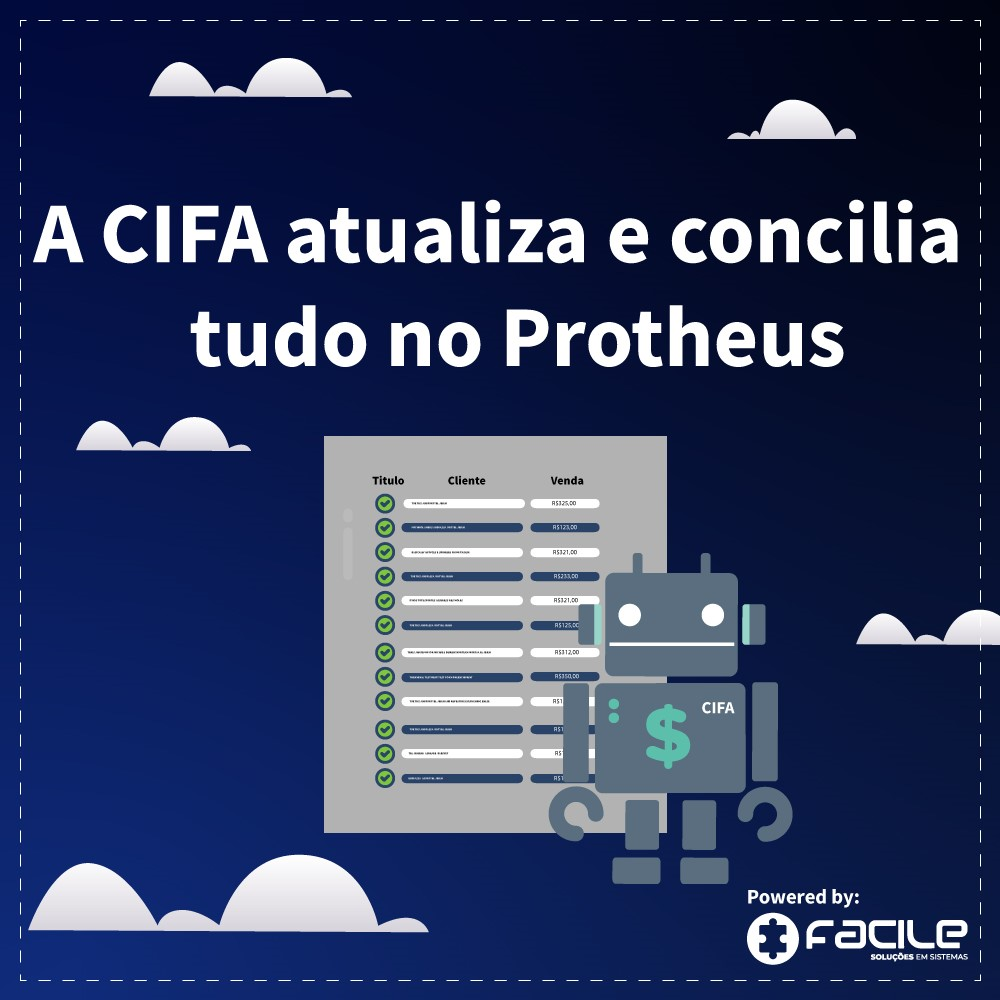
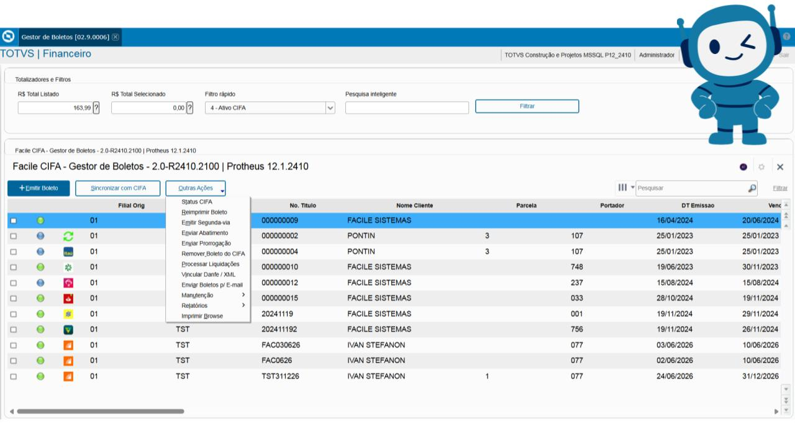
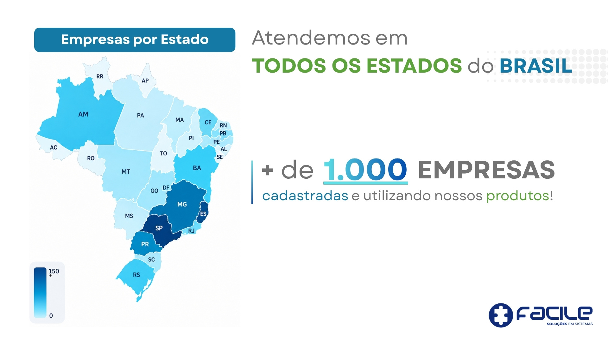

# Central de Inteligência Financeira Automática

# Extratos bancários em tempo real para o Protheus

A API de Extrato conecta o ERP Protheus diretamente aos bancos,
permitindo consultas em tempo real, conciliações automáticas e gestão financeira centralizada.

- Consultas instantâneas
- Atualização online
- Informações centralizadas
- Sem dependência de arquivos CNAB

# Como funciona o fluxo do sistema CIFA

**Conciliação Inteligente**

- Baixa automática
- Conciliação automática
- Regras configuráveis
- Redução de erros operacionais

**Aplicações Automáticas**

- Valor Aplicado
- Valor Resgatado
- Rendimentos
- Saldo Líquido
- Visibilidade completa sobre aplicações financeiras sem sair do ERP.

    

        
        
    

    

        
        
    

    

        
        
    

    

        
        
    

  

# Gestor de Boletos

**Reduza em até 99% o trabalho de conciliação da cobrança Bancária**

- Emita seus boletos automaticamente
- Disponibilize para seus clientes em todas as plataformas
- Cliente pagou? Ótimo, deixa que nós conciliamos para você
- Acelera os processos financeiros
- Evita erros humanos e prejuízos com retrabalho
- Gera liberdade para que seu negócio possa crescer

<a id="button" href="mailto:ar@facilesistemas.com.br?subject=Gostaria%20de%20ver%20uma%20apresenta%C3%A7%C3%A3o%20do%20CIFA&body=Ol%C3%A1%2C%20recebi%20um%20email%20sobre%20o%20CIFA%20e%20gostaria%20de%20ver%20funcionando%20na%20pr%C3%A1tica." class="btn btn-primary">Gostaria de ver funcionando na prática!</a>

## Vídeo de apresentação da ferramenta

<iframe width="560" height="315" src="https://www.youtube.com/embed/OJwXaMi6O28?si=ZXLC9a77WqG_0s8q" title="YouTube video player" frameborder="0" allow="accelerometer; autoplay; clipboard-write; encrypted-media; gyroscope; picture-in-picture; web-share" referrerpolicy="strict-origin-when-cross-origin" allowfullscreen></iframe>

 

<iframe width="560" height="315" src="https://www.youtube.com/embed/y5GYCR1nFz4?si=0sG7hwoHKeIP3n2_" title="YouTube video player" frameborder="0" allow="accelerometer; autoplay; clipboard-write; encrypted-media; gyroscope; picture-in-picture; web-share" referrerpolicy="strict-origin-when-cross-origin" allowfullscreen></iframe>

